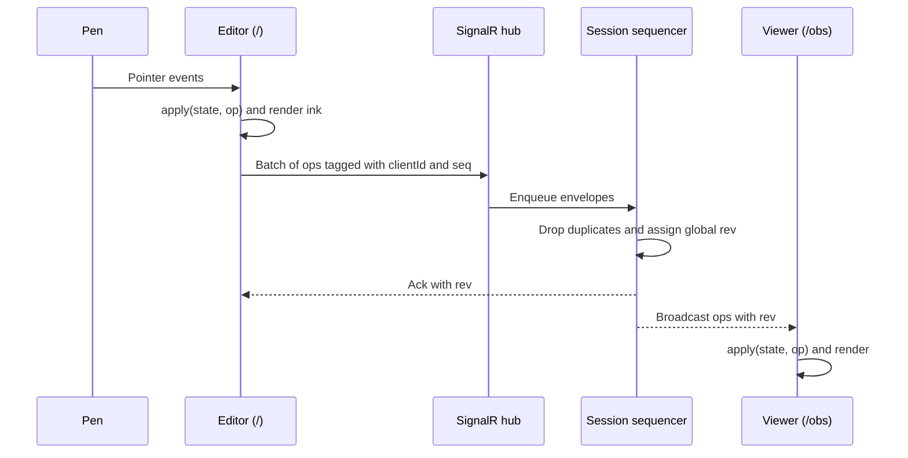
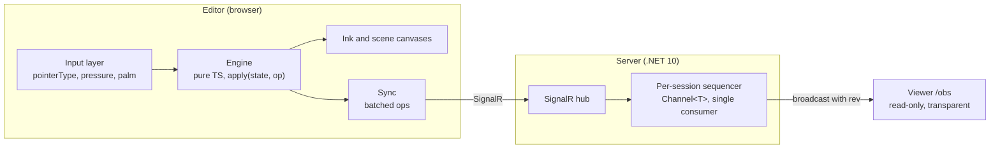
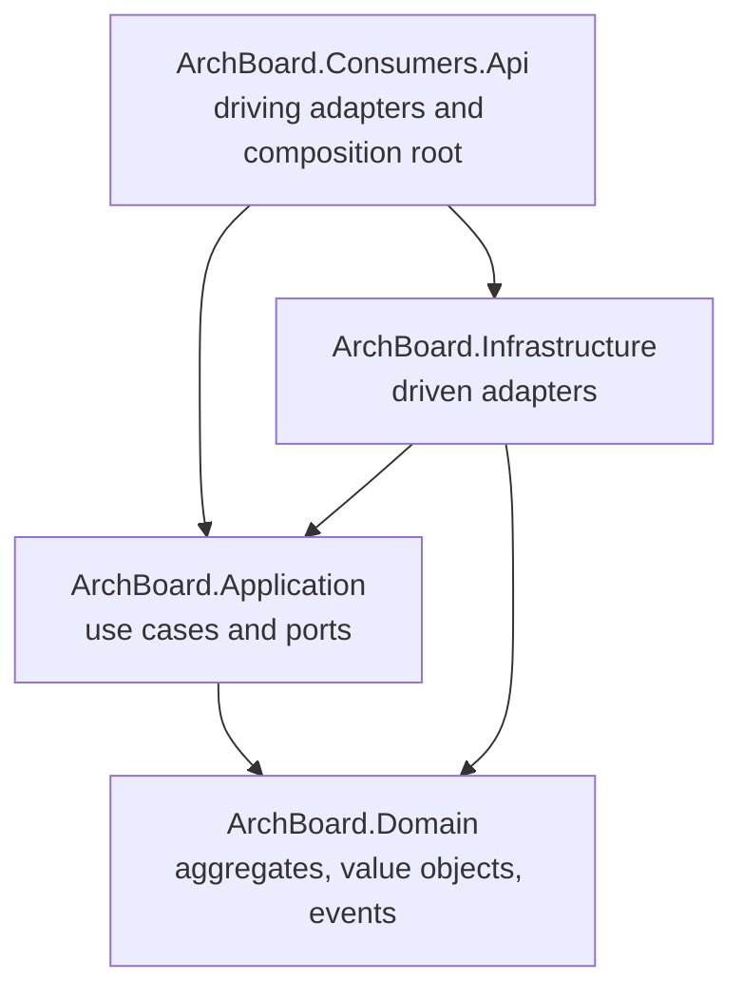

# ArchBoard

**English** | [Português (Brasil)](README.pt-BR.md)

A low-latency pen whiteboard that runs in the browser. Draw on an Android tablet, an iPad or a pen tablet and stream every stroke in real time to a read-only viewer with a transparent background, ready to be used as an overlay in streaming and recording tools.

> **Status: Phase 0 — ink spike.** The repository contains the scaffolding for the web app and the back-end. Feature work starts with Spike 0. Progress is tracked in [milestones](https://github.com/AntonioALino/ArchBoard/milestones) and [issues](https://github.com/AntonioALino/ArchBoard/issues).

## Table of contents

- [Why ArchBoard](#why-archboard)
- [Planned features](#planned-features)
- [How it works](#how-it-works)
- [Architecture](#architecture)
  - [Hot path and cold path](#hot-path-and-cold-path)
  - [Op protocol](#op-protocol)
  - [Front-end](#front-end)
  - [Back-end: hexagonal architecture](#back-end-hexagonal-architecture)
- [Repository layout](#repository-layout)
- [Tech stack](#tech-stack)
- [Getting started](#getting-started)
- [Phase 0: measuring ink latency](#phase-0-measuring-ink-latency)
- [Roadmap](#roadmap)
- [Architecture decisions](#architecture-decisions)
- [Engineering conventions](#engineering-conventions)
- [Security principles](#security-principles)
- [Contributing](#contributing)
- [License](#license)

## Why ArchBoard

Drawing on a tablet only feels natural when the latency between the pen and the ink is barely noticeable. ArchBoard treats that as a requirement you can measure:

- every latency mitigation is an **A/B toggle**;
- every toggle comes with a **measurement**;
- native apps such as **Samsung Notes** serve as the baseline.

The project is also a study of engineering trade-offs. The path from the pen to the viewer stays minimal and allocation-aware. Heavier patterns appear only where they solve a real problem, and **no optimization is accepted without a before/after number**.

## Planned features

| Feature | Phase |
|---|---|
| Low-latency inking with pressure, palm rejection and device-aware input | 0 |
| Real-time relay to a transparent, read-only viewer (`/obs`) | 1 |
| React editor with an accessible toolbar (keyboard, ARIA toolbar pattern, visible focus) | 2 |
| Stroke eraser (removes whole strokes; vector model preserved) | 2 |
| Board library with tags, status, search, filters and pagination | 3 |
| Ops Inspector: virtualized timeline of every op in a board | 3 |
| Reconnection without losing strokes (`lastRev`) | 4–5 |
| Cloud relay with blue-green deploys and full observability | 5 |
| Replay export to video | 6 |
| Optional AI suggestions for board title and tags (explicit opt-in) | 3+ |

## How it works

Every action on the board is an **op**: begin a stroke, add points, end a stroke, delete strokes, place an image. The editor applies ops locally first, so ink appears immediately, and then sends them in batches. The server orders the ops of each session and broadcasts them to every viewer.



- **Ordering:** each session has exactly one sequencer, so every viewer sees the same order.
- **Idempotency:** an op is identified by `(clientId, seq)`, so a retried batch never duplicates a stroke.
- **Confirmation:** a stroke is confirmed when its `end` op has been acknowledged.
- **Recovery:** a client that reconnects asks for every op after its `lastRev`.

## Architecture



### Hot path and cold path

The **hot path** is everything between the pen and the viewer: input → engine → ink layer → sync → hub → sequencer → viewer. It has strict rules:

| Forbidden on the hot path | Why |
|---|---|
| React in the drawing loop, `setState` per point | Re-rendering per pointer event costs frames |
| MediatR, EF Core or any ORM | Allocation and indirection per op |
| Heavy validation per op | The server treats the payload as opaque |
| Synchronous logging per op | I/O on every point; aggregated metrics are used instead |
| Network calls other than the batched send | Each call adds latency and jitter |

The **cold path** (library, accounts, cloud, export, observability) is where heavier patterns come in, each one only to solve a concrete problem.

### Op protocol

The protocol in `web/src/protocol` is the **contract** between editor, server and viewer. Ops are a TypeScript discriminated union validated with Zod schemas. On the wire, each op travels inside an envelope:

```json
{
  "clientId": "c7f1…",
  "seq": 42,
  "kind": "pts",
  "payload": { "…": "opaque to the server" }
}
```

| Kind | Meaning |
|---|---|
| `begin` | Start a stroke (id, color, width) |
| `pts` | Append points to the active stroke |
| `end` | Finish the stroke |
| `del` | Delete strokes by id (stroke eraser) |
| `img` | Place an image by `assetId` |

Rules:

- **The server does not understand geometry.** It stores and orders envelopes and never reads the payload. Geometry logic exists only in the TypeScript engine.
- Any protocol change requires an ADR and must stay compatible with older clients or be versioned.
- Assets are content-addressed: `POST /assets` and `GET /assets/{hash}`.

### Front-end

A single Vite project with multiple entry points, organized by feature and by component.

| Module | Responsibility | Rules |
|---|---|---|
| `protocol/` | Op types and Zod schemas | Shared contract; changes need an ADR |
| `engine/` | Scene state and the `apply(state, op)` reducer | **Pure TypeScript.** No React, no DOM UI, no UI libraries |
| `editor/` | `/` entry: input layer, toolbar, sync | Only the input layer knows about `pointerType`, pressure, tilt and palm |
| `viewer/` | `/obs` entry | Read-only, transparent background, minimal bundle |
| `library/` | Board library (Phase 3) | Loaded on demand |
| `inspector/` | Ops Inspector (Phase 3) | Loaded on demand, virtualized |
| `shared/` | Reusable components, hooks, utilities, types and styles | No feature-specific logic |
| `app/` | Root composition: providers and routes | — |

Design principles:

- **The engine is deterministic.** The same sequence of ops always produces the same state. No `Date.now()`, `Math.random()` or frame timing inside `apply`; smoothing depends only on the points.
- **World coordinates everywhere.** Pan and zoom are render transforms.
- **React only for UI.** The toolbar and screens read the engine through `useSyncExternalStore`, and the toolbar never re-renders during a stroke.
- **Three kinds of state, never mixed:** server state in TanStack Query, UI state (tool, color, width) in Zustand, scene state in the engine.
- **`useEffect` only to sync with external systems** (canvas, SignalR, subscriptions), never to derive state.

### Back-end: hexagonal architecture

The back-end follows **ports and adapters** with **Domain-Driven Design**. Dependencies always point inwards, toward the domain.



| Project | Responsibility | Folders |
|---|---|---|
| `ArchBoard.Domain` | Business model: aggregates, value objects, domain events and invariants (e.g. board status transitions). No dependencies on other projects or frameworks. | `Aggregates/`, `ValueObjects/`, `Events/`, `Exceptions/` |
| `ArchBoard.Application` | Use cases that orchestrate the domain. Defines the **ports**: inbound (what the outside world can ask) and outbound (what the application needs, such as persistence, broadcast or storage). | `Ports/Inbound/`, `Ports/Outbound/`, `UseCases/` |
| `ArchBoard.Infrastructure` | **Driven adapters** that implement the outbound ports: database, messaging, asset storage. | `Adapters/Persistence/`, `Adapters/Messaging/` |
| `ArchBoard.Consumers.Api` | **Driving adapters**: HTTP endpoints and SignalR hubs. Also the composition root that wires ports to adapters. Future consumers (for example an export worker) live next to it. | `Endpoints/`, `Hubs/` |

Rules:

- Endpoints and hubs stay thin: business rules live in the domain or in the application layer.
- The `viewer` role is validated **on the server**, in every hub method that writes.
- On the hot path, the sequencer stays lean: a `System.Threading.Channels` channel with a single consumer per session, no locks and no ORM.

## Repository layout

```
.
├── docs/
│   ├── adr/                         Architecture Decision Records
│   └── measurements/                Spike CSVs and results
├── server/
│   ├── ArchBoard.slnx
│   └── src/
│       ├── ArchBoard.Domain/
│       ├── ArchBoard.Application/
│       ├── ArchBoard.Infrastructure/
│       └── ArchBoard.Consumers.Api/
├── web/                             Vite + React + TypeScript
│   └── src/
│       ├── app/
│       ├── protocol/
│       ├── engine/
│       ├── editor/                  components/, hooks/, input/, sync/
│       ├── viewer/                  components/
│       ├── library/
│       ├── inspector/
│       ├── shared/                  components/, hooks/, lib/, types/, styles/
│       └── assets/
└── tools/
    └── analysis/                    Python notebooks for the measurements
```

## Tech stack

| Layer | Technologies |
|---|---|
| Front-end | Vite, TypeScript (strict), React 19, React Compiler, Zustand, TanStack Query, React Router, TanStack Virtual, Zod, Storybook, web-vitals |
| Back-end | .NET 10 (LTS), ASP.NET Core, SignalR, `System.Threading.Channels`, EF Core + Npgsql |
| Data | PostgreSQL |
| Tests | Vitest, React Testing Library, MSW, Playwright, xUnit, WebApplicationFactory, Testcontainers, Reqnroll |
| Quality | SonarQube Cloud, Dependabot |
| Infra | Docker, Docker Compose, GitHub Actions, GitHub Pages |
| Observability | OpenTelemetry (.NET and JS), Prometheus, Grafana, Loki |
| Export | MediaRecorder, Playwright headless, ffmpeg |
| Analysis | Python (pandas) |

**Technology entry rule:** a dependency comes in only when it solves a problem the project has *now*, and each one is recorded in a short ADR (problem, choice, discarded alternative). The table above is the target stack; most of it arrives in later phases.

## Getting started

### Prerequisites

- [.NET 10 SDK](https://dotnet.microsoft.com/download)
- [Node.js](https://nodejs.org/) in a version supported by Vite (see the [Vite guide](https://vite.dev/guide/))
- Git

### Clone

```bash
git clone https://github.com/AntonioALino/ArchBoard.git
cd ArchBoard
```

### Web

```bash
cd web
npm install
npm run dev
```

| Script | What it does |
|---|---|
| `npm run dev` | Starts the Vite dev server |
| `npm run build` | Type-checks and builds for production |
| `npm run preview` | Serves the production build locally |
| `npm run lint` | Runs the linter |

### Server

```bash
dotnet build server/ArchBoard.slnx
dotnet run --project server/src/ArchBoard.Consumers.Api
```

The API listens on `http://localhost:5067` (HTTPS profile: `https://localhost:7111`), as configured in `Properties/launchSettings.json`.

### Testing on a real tablet

Pen latency must be measured on the real device. Options:

- **Phase 0:** open the GitHub Pages deployment on the tablet.
- **Phase 1+:** connect an Android tablet over USB and forward the dev ports with `adb reverse tcp:<port> tcp:<port>`, so the tablet reaches `localhost` on your machine.

## Phase 0: measuring ink latency

Spike 0 is a plain Vite + TypeScript page (no React, no back-end) that answers one question: *how close can browser ink get to a native app?*

It uses two stacked canvases: a **scene** layer for committed strokes and an **ink** layer for the active stroke. Every mitigation can be switched at runtime:

| Toggle | Purpose |
|---|---|
| `desynchronized` canvas context | Low-latency rendering that bypasses part of the compositor sync, where supported |
| `getCoalescedEvents()` | Recovers intermediate points the browser merged into a single event |
| `getPredictedEvents()` | Draws predicted points to hide latency; they are replaced by real points |
| `touch-action: none` | Stops browser gestures (scroll, zoom) from taking over pointer events |
| `pointerType` filter | Accepts pen only, or pen and touch |
| Palm rejection | Ignores contacts that look like a resting hand |

The metrics HUD reports events per second, frame time p95, observed `pointerType` and pressure, and ghost touches. Measurements are exported as CSV, analyzed with pandas in `tools/analysis/`, and stored in `docs/measurements/`.

**Phase 0 is done** when the measurements on the tested tablet, compared with Samsung Notes, are committed to `docs/measurements/`.

## Roadmap

| Phase | Goal | Done when |
|---|---|---|
| **0 · Ink spike** | Low-latency ink in the browser, A/B toggles, metrics HUD, CSV export, GitHub Pages deploy | Tablet measurements vs Samsung Notes are in `docs/measurements/` |
| **1 · Realtime relay** | SignalR relay hub, transparent `/obs` viewer, client/server/viewer timestamps | End-to-end latency is measured and the go/no-go decision is in an ADR |
| **2 · React editor** | Op protocol with Zod, deterministic engine, React 19 toolbar via `useSyncExternalStore`, Zustand, React Compiler, accessible toolbar | The Profiler shows zero toolbar re-renders during a stroke, Phase 0 metrics hold, and engine tests (determinism, idempotency) pass |
| **3 · Library and API** | Boards module, CQRS on the op log (append-only with snapshots), PostgreSQL, React Router, TanStack Query, virtualized Ops Inspector, Storybook | Search with filters, pagination and realtime can be demonstrated, with Profiler numbers before/after for the Inspector |
| **4 · Quality and security** | Test pyramid, Playwright with editor and viewer, Testcontainers, security hardening, SonarQube Cloud | CI blocks PRs without tests or with a red quality gate |
| **5 · Cloud and production** | Multi-stage Docker image, blue-green deploy, Redis backplane, OpenTelemetry, feature flags | A blue-green deploy during a live session loses no stroke, proven in Grafana |
| **6 · Replay export** | In-browser export with MediaRecorder; a worker with Outbox and RabbitMQ only if an ADR justifies it | An export request survives a worker crash and runs exactly once |

> **Scaling note:** the Redis backplane does not guarantee ordering. Since each session needs a single sequencer, horizontal scaling requires session affinity.

## Architecture decisions

Decisions are recorded as ADRs in [`docs/adr/`](docs/adr), one file per decision:

```markdown
# NNNN. Title

- Status: proposed | accepted | superseded by NNNN
- Date: YYYY-MM-DD

## Context
## Decision
## Alternatives considered
## Consequences
```

| ADR | Decision | Tracking |
|---|---|---|
| 0001 | Web (React + TypeScript) as the single platform for Android tablet, iPad and pen tablet | [#8](https://github.com/AntonioALino/ArchBoard/issues/8) |
| 0002 | The server does not understand geometry (opaque payload) | [#9](https://github.com/AntonioALino/ArchBoard/issues/9) |
| 0003 | Per-session sequencer with `Channel<T>` and a single consumer | [#10](https://github.com/AntonioALino/ArchBoard/issues/10) |
| 0004 | Stroke eraser in the MVP (no pixel eraser) | [#11](https://github.com/AntonioALino/ArchBoard/issues/11) |
| 0005 | Append-only persistence with snapshots | [#12](https://github.com/AntonioALino/ArchBoard/issues/12) |
| 0006 | Hexagonal back-end (Consumers / Application / Domain / Infrastructure) | [#13](https://github.com/AntonioALino/ArchBoard/issues/13) |
| 0007 | Linter: oxlint vs ESLint | [#14](https://github.com/AntonioALino/ArchBoard/issues/14) |

Open questions: PostgreSQL or SQLite first for local mode, Azure Container Apps or a VPS in Phase 5, and whether to adopt MediatR (commercial license with a Community edition).

## Engineering conventions

### TypeScript

- `strict: true` and `noUncheckedIndexedAccess: true`.
- No `any`. External data enters as `unknown` and is parsed with a Zod schema.
- String literal unions instead of `enum`; every `switch` over a union ends with `assertNever`.
- Named exports. One module, one responsibility.

### React

- Interactive components have an accessible name, keyboard navigation and visible focus; targets are at least 24×24 px.
- Status is never conveyed by color alone.

### C#

- `<Nullable>enable</Nullable>` and `<TreatWarningsAsErrors>true</TreatWarningsAsErrors>`.
- Every async method accepts and forwards a `CancellationToken`. No `async void`.
- DTOs and envelopes are `sealed record`.

### Tests

- Names describe behavior: `apply_ignores_pts_for_unknown_stroke`, `Sequencer_drops_duplicate_op`.
- Test behavior, not implementation.
- The engine, the protocol and the sequencer always have tests.

### Observability

- Metrics and spans use the `archboard.` prefix (e.g. `archboard.sequencer.queue_length`).
- No per-op logging on the hot path; use aggregated metrics.

### Performance

- Every optimization comes with a measurement before and after. No number, no optimization.

## Security principles

- No secrets in code; configuration comes from environment variables, and `.env` files stay out of Git.
- Authentication with httpOnly, SameSite cookies and antiforgery; no tokens in `localStorage`.
- Strict Content Security Policy.
- Uploads are validated by type and size; SVG is blocked; assets are served with `X-Content-Type-Options: nosniff`.
- Rate limiting on the API and an ops-per-second limit on the hub.
- Boards may contain private material: nothing is sent to external services without explicit opt-in, and AI API keys live only on the server.

## Contributing

1. Pick an issue from the current [milestone](https://github.com/AntonioALino/ArchBoard/milestones).
2. Create a branch and keep the PR small and focused.
3. Use [Conventional Commits](https://www.conventionalcommits.org/): `feat:`, `fix:`, `test:`, `docs:`, `refactor:`, `chore:`.
4. Include tests for engine, protocol and sequencer changes, and measurements for performance changes.
5. If the change involves an architecture decision, add or update an ADR.

## License

[MIT](LICENSE)
