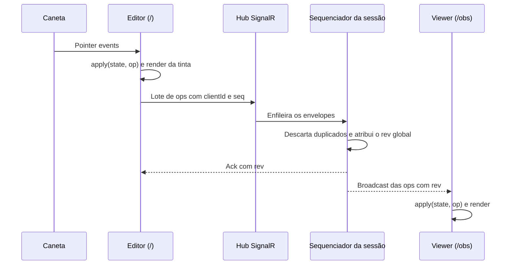
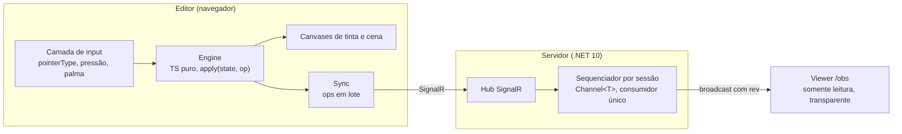
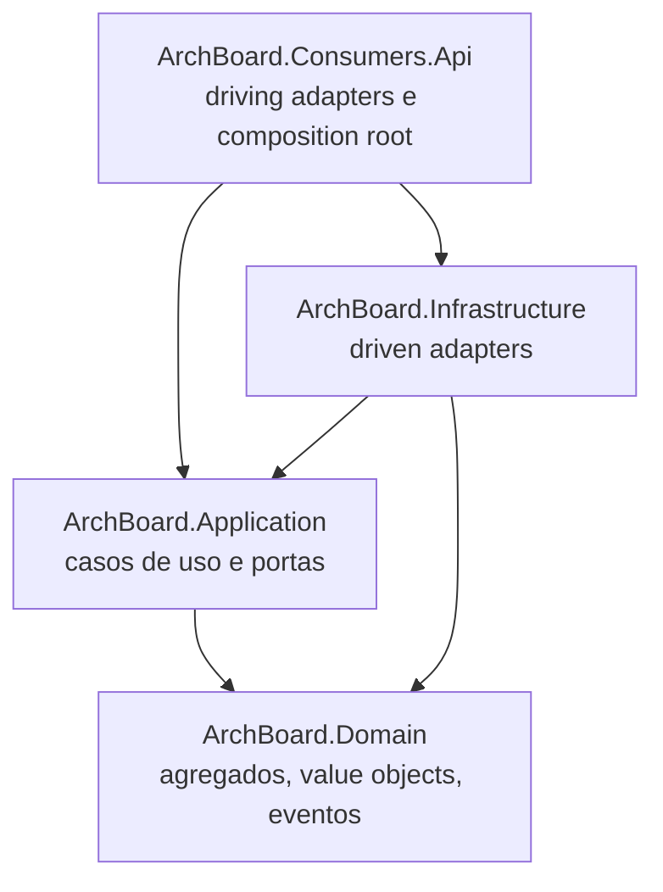

# ArchBoard

[English](README.md) | **Português (Brasil)**

Um quadro branco para caneta, de baixa latência, que roda no navegador. Desenhe em um tablet Android, em um iPad ou em uma mesa digitalizadora e transmita cada traço em tempo real para um viewer somente leitura e com fundo transparente, pronto para ser usado como overlay em ferramentas de transmissão e gravação.

> **Status: Fase 0 — spike de tinta.** O repositório tem o scaffolding do app web e do back-end. O desenvolvimento das funcionalidades começa pelo Spike 0. O progresso fica nas [milestones](https://github.com/AntonioALino/ArchBoard/milestones) e nas [issues](https://github.com/AntonioALino/ArchBoard/issues).

## Sumário

- [Por que o ArchBoard](#por-que-o-archboard)
- [Funcionalidades planejadas](#funcionalidades-planejadas)
- [Como funciona](#como-funciona)
- [Arquitetura](#arquitetura)
  - [Caminho quente e caminho frio](#caminho-quente-e-caminho-frio)
  - [Protocolo de ops](#protocolo-de-ops)
  - [Front-end](#front-end)
  - [Back-end: arquitetura hexagonal](#back-end-arquitetura-hexagonal)
- [Estrutura do repositório](#estrutura-do-repositório)
- [Stack](#stack)
- [Como rodar](#como-rodar)
- [Fase 0: medindo a latência da tinta](#fase-0-medindo-a-latência-da-tinta)
- [Roadmap](#roadmap)
- [Decisões de arquitetura](#decisões-de-arquitetura)
- [Convenções de engenharia](#convenções-de-engenharia)
- [Princípios de segurança](#princípios-de-segurança)
- [Contribuindo](#contribuindo)
- [Licença](#licença)

## Por que o ArchBoard

Desenhar em um tablet só parece natural quando a latência entre a caneta e a tinta é quase imperceptível. O ArchBoard trata isso como um requisito mensurável:

- cada mitigação de latência é um **toggle A/B**;
- cada toggle vem com uma **medição**;
- apps nativos como o **Samsung Notes** servem de referência.

O projeto também é um estudo de trade-offs de engenharia. O caminho entre a caneta e o viewer fica mínimo e atento a alocações. Padrões mais pesados aparecem só onde resolvem um problema real, e **nenhuma otimização é aceita sem um número de antes e depois**.

## Funcionalidades planejadas

| Funcionalidade | Fase |
|---|---|
| Tinta de baixa latência com pressão, rejeição de palma e input sensível ao dispositivo | 0 |
| Relay em tempo real para um viewer transparente e somente leitura (`/obs`) | 1 |
| Editor em React com toolbar acessível (teclado, padrão ARIA toolbar, foco visível) | 2 |
| Borracha de traço (remove traços inteiros; o modelo vetorial é preservado) | 2 |
| Biblioteca de quadros com tags, status, busca, filtros e paginação | 3 |
| Inspetor de ops: linha do tempo virtualizada de todas as ops de um quadro | 3 |
| Reconexão sem perder traços (`lastRev`) | 4–5 |
| Relay na nuvem com deploy blue-green e observabilidade completa | 5 |
| Exportação do replay em vídeo | 6 |
| Sugestão opcional de título e tags com IA (opt-in explícito) | 3+ |

## Como funciona

Toda ação no quadro é uma **op**: começar um traço, adicionar pontos, terminar um traço, apagar traços, inserir uma imagem. O editor aplica as ops localmente primeiro, para a tinta aparecer na hora, e depois as envia em lote. O servidor ordena as ops de cada sessão e faz o broadcast para todos os viewers.



- **Ordem:** cada sessão tem exatamente um sequenciador, então todos os viewers veem a mesma ordem.
- **Idempotência:** uma op é identificada por `(clientId, seq)`, então reenviar um lote nunca duplica um traço.
- **Confirmação:** um traço está confirmado quando a op `end` recebeu ack.
- **Recuperação:** um cliente que reconecta pede todas as ops depois do seu `lastRev`.

## Arquitetura



### Caminho quente e caminho frio

O **caminho quente** é tudo entre a caneta e o viewer: input → engine → camada de tinta → sync → hub → sequenciador → viewer. Ele tem regras rígidas:

| Proibido no caminho quente | Por quê |
|---|---|
| React no loop de desenho, `setState` por ponto | Re-render por pointer event custa frames |
| MediatR, EF Core ou qualquer ORM | Alocação e indireção por op |
| Validação pesada por op | O servidor trata o payload como opaco |
| Log síncrono por op | I/O a cada ponto; usam-se métricas agregadas |
| Chamadas de rede além do envio em lote | Cada chamada soma latência e jitter |

O **caminho frio** (biblioteca, contas, nuvem, exportação, observabilidade) é onde entram os padrões mais pesados, cada um só para resolver um problema concreto.

### Protocolo de ops

O protocolo em `web/src/protocol` é o **contrato** entre editor, servidor e viewer. As ops são uma discriminated union em TypeScript, validada com schemas Zod. Na rede, cada op viaja dentro de um envelope:

```json
{
  "clientId": "c7f1…",
  "seq": 42,
  "kind": "pts",
  "payload": { "…": "opaco para o servidor" }
}
```

| Kind | Significado |
|---|---|
| `begin` | Começa um traço (id, cor, espessura) |
| `pts` | Anexa pontos ao traço ativo |
| `end` | Termina o traço |
| `del` | Apaga traços pelos ids (borracha de traço) |
| `img` | Insere uma imagem pelo `assetId` |

Regras:

- **O servidor não entende geometria.** Ele guarda e ordena envelopes e nunca lê o payload. A lógica de geometria existe só no engine em TypeScript.
- Qualquer mudança no protocolo exige ADR e precisa ser compatível com clientes antigos ou versionada.
- Os assets são endereçados por conteúdo: `POST /assets` e `GET /assets/{hash}`.

### Front-end

Um único projeto Vite com múltiplas entradas, organizado por feature e por componente.

| Módulo | Responsabilidade | Regras |
|---|---|---|
| `protocol/` | Tipos de op e schemas Zod | Contrato compartilhado; mudanças exigem ADR |
| `engine/` | Estado da cena e o reducer `apply(state, op)` | **TypeScript puro.** Sem React, sem DOM de UI, sem bibliotecas de UI |
| `editor/` | Entrada `/`: camada de input, toolbar, sync | Só a camada de input conhece `pointerType`, pressão, inclinação e palma |
| `viewer/` | Entrada `/obs` | Somente leitura, fundo transparente, bundle mínimo |
| `library/` | Biblioteca de quadros (Fase 3) | Carregada sob demanda |
| `inspector/` | Inspetor de ops (Fase 3) | Carregado sob demanda, virtualizado |
| `shared/` | Componentes, hooks, utilitários, tipos e estilos reutilizáveis | Sem lógica específica de feature |
| `app/` | Composição raiz: providers e rotas | — |

Princípios de design:

- **O engine é determinístico.** A mesma sequência de ops gera sempre o mesmo estado. Nada de `Date.now()`, `Math.random()` ou timing de frame dentro do `apply`; a suavização depende só dos pontos.
- **Coordenadas de mundo em todo lugar.** Pan e zoom são transformações de render.
- **React só para a UI.** A toolbar e as telas leem o engine via `useSyncExternalStore`, e a toolbar não renderiza de novo durante um traço.
- **Três tipos de estado, nunca misturados:** estado de servidor no TanStack Query, estado de UI (ferramenta, cor, espessura) no Zustand, estado da cena no engine.
- **`useEffect` só para sincronizar com sistemas externos** (canvas, SignalR, assinaturas), nunca para derivar estado.

### Back-end: arquitetura hexagonal

O back-end segue **ports and adapters** com **Domain-Driven Design**. As dependências sempre apontam para dentro, em direção ao domínio.



| Projeto | Responsabilidade | Pastas |
|---|---|---|
| `ArchBoard.Domain` | Modelo de negócio: agregados, value objects, eventos de domínio e invariantes (por exemplo, as transições de status do quadro). Não depende de outros projetos nem de frameworks. | `Aggregates/`, `ValueObjects/`, `Events/`, `Exceptions/` |
| `ArchBoard.Application` | Casos de uso que orquestram o domínio. Define as **portas**: de entrada (o que o mundo externo pode pedir) e de saída (o que a aplicação precisa, como persistência, broadcast ou armazenamento). | `Ports/Inbound/`, `Ports/Outbound/`, `UseCases/` |
| `ArchBoard.Infrastructure` | **Driven adapters** que implementam as portas de saída: banco de dados, mensageria, armazenamento de assets. | `Adapters/Persistence/`, `Adapters/Messaging/` |
| `ArchBoard.Consumers.Api` | **Driving adapters**: endpoints HTTP e hubs SignalR. Também é o composition root que liga portas a adapters. Consumers futuros (por exemplo, um worker de exportação) ficam ao lado dele. | `Endpoints/`, `Hubs/` |

Regras:

- Endpoints e hubs ficam finos: a regra de negócio mora no domínio ou na camada de aplicação.
- O papel `viewer` é validado **no servidor**, em todo método do hub que grava.
- No caminho quente, o sequenciador fica enxuto: um canal de `System.Threading.Channels` com um único consumidor por sessão, sem locks e sem ORM.

## Estrutura do repositório

```
.
├── docs/
│   ├── adr/                         Architecture Decision Records
│   └── measurements/                CSVs e resultados dos spikes
├── server/
│   ├── ArchBoard.slnx
│   └── src/
│       ├── ArchBoard.Domain/
│       ├── ArchBoard.Application/
│       ├── ArchBoard.Infrastructure/
│       └── ArchBoard.Consumers.Api/
├── web/                             Vite + React + TypeScript
│   └── src/
│       ├── app/
│       ├── protocol/
│       ├── engine/
│       ├── editor/                  components/, hooks/, input/, sync/
│       ├── viewer/                  components/
│       ├── library/
│       ├── inspector/
│       ├── shared/                  components/, hooks/, lib/, types/, styles/
│       └── assets/
└── tools/
    └── analysis/                    Notebooks Python das medições
```

## Stack

| Camada | Tecnologias |
|---|---|
| Front-end | Vite, TypeScript (strict), React 19, React Compiler, Zustand, TanStack Query, React Router, TanStack Virtual, Zod, Storybook, web-vitals |
| Back-end | .NET 10 (LTS), ASP.NET Core, SignalR, `System.Threading.Channels`, EF Core + Npgsql |
| Dados | PostgreSQL |
| Testes | Vitest, React Testing Library, MSW, Playwright, xUnit, WebApplicationFactory, Testcontainers, Reqnroll |
| Qualidade | SonarQube Cloud, Dependabot |
| Infra | Docker, Docker Compose, GitHub Actions, GitHub Pages |
| Observabilidade | OpenTelemetry (.NET e JS), Prometheus, Grafana, Loki |
| Exportação | MediaRecorder, Playwright headless, ffmpeg |
| Análise | Python (pandas) |

**Regra de entrada de tecnologia:** uma dependência só entra quando resolve um problema que o projeto tem *agora*, e cada uma é registrada em um ADR curto (problema, escolha, alternativa descartada). A tabela acima é a stack-alvo; a maior parte chega nas próximas fases.

## Como rodar

### Pré-requisitos

- [.NET 10 SDK](https://dotnet.microsoft.com/download)
- [Node.js](https://nodejs.org/) em uma versão suportada pelo Vite (veja o [guia do Vite](https://vite.dev/guide/))
- Git

### Clonar

```bash
git clone https://github.com/AntonioALino/ArchBoard.git
cd ArchBoard
```

### Web

```bash
cd web
npm install
npm run dev
```

| Script | O que faz |
|---|---|
| `npm run dev` | Sobe o servidor de desenvolvimento do Vite |
| `npm run build` | Checa os tipos e gera o build de produção |
| `npm run preview` | Serve o build de produção localmente |
| `npm run lint` | Roda o linter |

### Servidor

```bash
dotnet build server/ArchBoard.slnx
dotnet run --project server/src/ArchBoard.Consumers.Api
```

A API escuta em `http://localhost:5067` (perfil HTTPS: `https://localhost:7111`), conforme o `Properties/launchSettings.json`.

### Testando em um tablet de verdade

A latência da caneta precisa ser medida no dispositivo real. Opções:

- **Fase 0:** abra o deploy do GitHub Pages no tablet.
- **Fase 1 em diante:** conecte um tablet Android por USB e redirecione as portas de desenvolvimento com `adb reverse tcp:<porta> tcp:<porta>`, para o tablet acessar o `localhost` da sua máquina.

## Fase 0: medindo a latência da tinta

O Spike 0 é uma página Vite + TypeScript pura (sem React, sem back-end) que responde a uma pergunta: *quão perto a tinta no navegador chega de um app nativo?*

Ele usa dois canvases sobrepostos: uma camada de **cena** para os traços finalizados e uma camada de **tinta** para o traço ativo. Cada mitigação pode ser ligada e desligada em tempo de execução:

| Toggle | Para quê |
|---|---|
| Contexto de canvas `desynchronized` | Render de baixa latência que contorna parte da sincronização do compositor, onde há suporte |
| `getCoalescedEvents()` | Recupera os pontos intermediários que o navegador juntou em um único evento |
| `getPredictedEvents()` | Desenha pontos previstos para esconder a latência; eles são substituídos pelos pontos reais |
| `touch-action: none` | Impede que gestos do navegador (scroll, zoom) tomem os pointer events |
| Filtro por `pointerType` | Aceita só caneta, ou caneta e toque |
| Rejeição de palma | Ignora contatos que parecem a mão apoiada |

O HUD de métricas mostra eventos por segundo, frame time p95, `pointerType` e pressão observados e toques fantasmas. As medições são exportadas em CSV, analisadas com pandas em `tools/analysis/` e guardadas em `docs/measurements/`.

**A Fase 0 está pronta** quando as medições do tablet testado, comparadas com o Samsung Notes, estiverem commitadas em `docs/measurements/`.

## Roadmap

| Fase | Objetivo | Pronto quando |
|---|---|---|
| **0 · Spike de tinta** | Tinta de baixa latência no navegador, toggles A/B, HUD de métricas, exportação em CSV, deploy no GitHub Pages | As medições do tablet comparadas ao Samsung Notes estiverem em `docs/measurements/` |
| **1 · Relay em tempo real** | Hub SignalR de relay, viewer `/obs` transparente, timestamps no cliente, servidor e viewer | A latência ponta a ponta estiver medida e a decisão de seguir estiver em ADR |
| **2 · Editor em React** | Protocolo de ops com Zod, engine determinístico, toolbar React 19 via `useSyncExternalStore`, Zustand, React Compiler, toolbar acessível | O Profiler mostrar zero re-render da toolbar durante um traço, as métricas da Fase 0 se mantiverem e os testes do engine (determinismo, idempotência) passarem |
| **3 · Biblioteca e API** | Módulo Boards, CQRS no log de ops (append-only com snapshots), PostgreSQL, React Router, TanStack Query, Inspetor de ops virtualizado, Storybook | Busca com filtros, paginação e tempo real puderem ser demonstrados, com números do Profiler antes e depois no Inspetor |
| **4 · Qualidade e segurança** | Pirâmide de testes, Playwright com editor e viewer, Testcontainers, hardening de segurança, SonarQube Cloud | O CI bloquear PR sem teste ou com quality gate vermelho |
| **5 · Nuvem e produção** | Imagem Docker multi-stage, deploy blue-green, backplane Redis, OpenTelemetry, feature flags | Um deploy blue-green durante uma sessão ao vivo não perder nenhum traço, comprovado no Grafana |
| **6 · Exportação de replay** | Exportação no navegador com MediaRecorder; worker com Outbox e RabbitMQ só se um ADR justificar | Um pedido de exportação sobreviver à queda do worker e rodar uma única vez |

> **Nota sobre escala:** o backplane do Redis não garante ordem. Como cada sessão precisa de um único sequenciador, a escala horizontal exige afinidade por sessão.

## Decisões de arquitetura

As decisões são registradas como ADRs em [`docs/adr/`](docs/adr), um arquivo por decisão:

```markdown
# NNNN. Title

- Status: proposed | accepted | superseded by NNNN
- Date: YYYY-MM-DD

## Context
## Decision
## Alternatives considered
## Consequences
```

| ADR | Decisão | Acompanhamento |
|---|---|---|
| 0001 | Web (React + TypeScript) como plataforma única para tablet Android, iPad e mesa digitalizadora | [#8](https://github.com/AntonioALino/ArchBoard/issues/8) |
| 0002 | O servidor não entende geometria (payload opaco) | [#9](https://github.com/AntonioALino/ArchBoard/issues/9) |
| 0003 | Sequenciador por sessão com `Channel<T>` e um único consumidor | [#10](https://github.com/AntonioALino/ArchBoard/issues/10) |
| 0004 | Borracha de traço no MVP (sem borracha de pixel) | [#11](https://github.com/AntonioALino/ArchBoard/issues/11) |
| 0005 | Persistência append-only com snapshots | [#12](https://github.com/AntonioALino/ArchBoard/issues/12) |
| 0006 | Back-end hexagonal (Consumers / Application / Domain / Infrastructure) | [#13](https://github.com/AntonioALino/ArchBoard/issues/13) |
| 0007 | Linter: oxlint ou ESLint | [#14](https://github.com/AntonioALino/ArchBoard/issues/14) |

Em aberto: PostgreSQL ou SQLite primeiro no modo local, Azure Container Apps ou VPS na Fase 5, e a adoção do MediatR (licença comercial, com edição Community).

## Convenções de engenharia

### TypeScript

- `strict: true` e `noUncheckedIndexedAccess: true`.
- Proibido `any`. Dados externos entram como `unknown` e passam por um schema Zod.
- Unions de literais em vez de `enum`; todo `switch` sobre union termina com `assertNever`.
- Exports nomeados. Um módulo, uma responsabilidade.

### React

- Componentes interativos têm nome acessível, navegação por teclado e foco visível; os alvos têm no mínimo 24×24 px.
- Status nunca é indicado só por cor.

### C#

- `<Nullable>enable</Nullable>` e `<TreatWarningsAsErrors>true</TreatWarningsAsErrors>`.
- Todo método assíncrono recebe e repassa `CancellationToken`. Proibido `async void`.
- DTOs e envelopes são `sealed record`.

### Testes

- Os nomes descrevem comportamento: `apply_ignores_pts_for_unknown_stroke`, `Sequencer_drops_duplicate_op`.
- Teste o comportamento, não a implementação.
- Engine, protocolo e sequenciador sempre têm testes.

### Observabilidade

- Métricas e spans usam o prefixo `archboard.` (por exemplo, `archboard.sequencer.queue_length`).
- Nada de log por op no caminho quente; use métricas agregadas.

### Desempenho

- Toda otimização vem com medição antes e depois. Sem número, não há otimização.

## Princípios de segurança

- Nada de segredos no código; a configuração vem de variáveis de ambiente, e os arquivos `.env` ficam fora do Git.
- Autenticação com cookies httpOnly e SameSite, mais antiforgery; nada de token no `localStorage`.
- Content Security Policy estrita.
- Uploads validados por tipo e tamanho; SVG bloqueado; assets servidos com `X-Content-Type-Options: nosniff`.
- Rate limiting na API e limite de ops por segundo no hub.
- Quadros podem conter material privado: nada é enviado a serviços externos sem opt-in explícito, e as chaves de API de IA ficam só no servidor.

## Contribuindo

1. Escolha uma issue da [milestone](https://github.com/AntonioALino/ArchBoard/milestones) atual.
2. Crie uma branch e mantenha o PR pequeno e focado.
3. Use [Conventional Commits](https://www.conventionalcommits.org/pt-br/): `feat:`, `fix:`, `test:`, `docs:`, `refactor:`, `chore:`.
4. Inclua testes em mudanças no engine, no protocolo e no sequenciador, e medições em mudanças de desempenho.
5. Se a mudança envolver uma decisão de arquitetura, crie ou atualize um ADR.

## Licença

[MIT](LICENSE)
